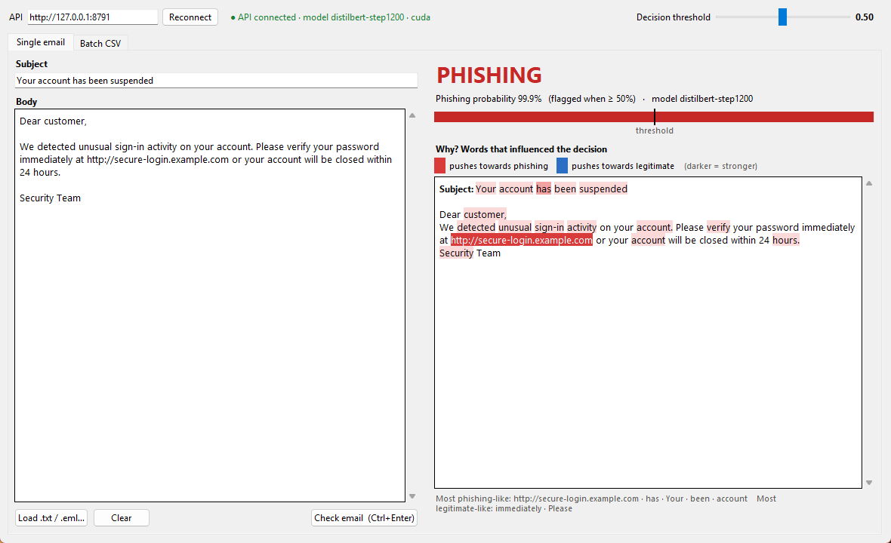
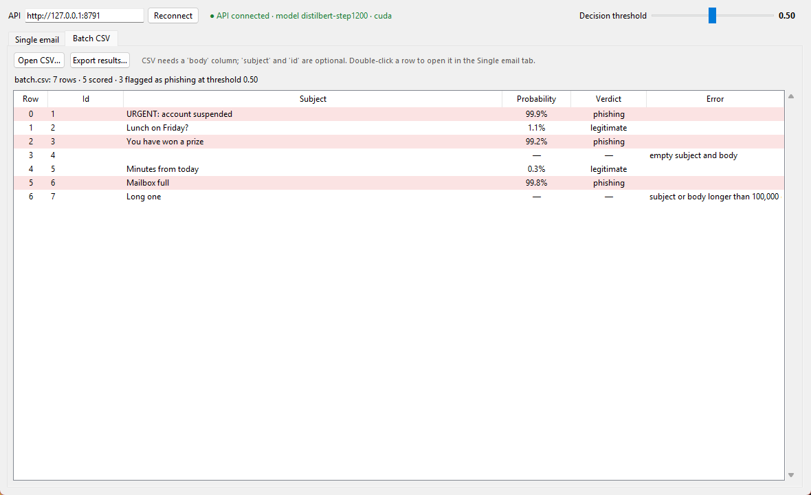

# ITRI625: Phishing Email Classifier

This project classifies emails as **legitimate (0)** or **phishing / spam (1)**. The main model is a
fine-tuned **DistilBERT** transformer, compared against a **TF-IDF + Logistic Regression** baseline.
A **FastAPI** service serves the model, and a **Tkinter** desktop app calls it. The app shows the
verdict, the probability, and the words that drove the decision, using Integrated Gradients.

## Results at a glance

Test set: 11,136 emails, never used for any decision before the final evaluation.

| model | accuracy | precision | recall | F1 | AUC-ROC | errors | false alarms | missed |
|---|---|---|---|---|---|---|---|---|
| DistilBERT (fine-tuned) | 0.9892 | 0.9915 | 0.9864 | 0.9889 | 0.9994 | 120 | **46** | 74 |
| TF-IDF + Logistic Regression | **0.9913** | 0.9890 | **0.9932** | **0.9911** | **0.9997** | **97** | 60 | **37** |

Key findings (details in the notebook; a write-up guide with all numbers is in [docs/theory_notes.md](docs/theory_notes.md)):
* **Data:** the dataset merges six older corpora, and its "phishing" label also covers generic
  spam and advance-fee fraud. 8,237 duplicates were removed **before** splitting. Leakage
  fingerprints (years, email addresses, header lines, a mailbox owner's name) were removed, and
  the remaining corpus signal was measured.
* **Models:** a well-tuned linear baseline **matches** DistilBERT on this data. DistilBERT raises fewer
  false alarms, and the baseline misses less. Both partly recognise *which corpus* an email came from
  (e.g. `enron`, `opensuse`), which won't transfer to other inboxes.
* **Explainability:** Integrated Gradients explanations pass a completeness check and a deletion
  test. Removing the words IG ranks highest hurts detection more than removing random words.
* **Robustness:** typos and look-alike (Cyrillic) letters don't let phishing evade DistilBERT. But it
  learned that odd-looking text means spam, so it also flags 52–64% of heavily perturbed
  *legitimate* emails, against 2–7% for TF-IDF.

## Repository layout

```
notebooks/itri625_phishing.ipynb   THE notebook: data, model, training loop, evaluation, XAI, robustness
                                   (all model code lives here; committed WITH outputs)
src/                               data download + cleaning pipeline, leakage checks, plot style
api/                               FastAPI service (main.py = real model, mock_app.py = fake scores)
app/                               Tkinter desktop client
scripts/check_app_e2e.py           end-to-end check: desktop app + real API (17 checks)
tests/                             pytest: API contract, training/serving parity, app, cleaning
figures/                           every plot, saved as PNG
results/                           training log, metric tables, predictions, robustness results (CSV/JSON)
docs/                              API contract, desktop app spec, theory notes, screenshots
Dockerfile, requirements-api.txt   containerised API (CPU)
models/                            trained weights (not in git, see "Model weights")
data/raw, data/processed           dataset + saved splits (not in git, see "Data")
```

## The notebook

`notebooks/itri625_phishing.ipynb` runs top to bottom on a fresh kernel. Every figure, table and
metric is saved in the committed file, so you can read it on GitHub without running anything.

| section | contents |
|---|---|
| 1 | setup, device check |
| 2 | data: sources, what the labels mean, cleaning rules, deduplication, corpus-leakage checks, stratified 70/15/15 split |
| 3 | DistilBERT: architecture, **one config cell**, token lengths, custom PyTorch training loop (AdamW, linear warm-up, bf16), logging every 200 steps, **early stopping** with best-checkpoint restore |
| 4 | evaluation: loss/metric curves, test metrics, classification report, ROC/PR, confusion matrices, per-source results, error analysis, TF-IDF baseline and comparison |
| 5 | Integrated Gradients (completeness check, examples, deletion test, global words) and robustness to typos, homoglyphs and synonyms |

Flags in the config cell: `RETRAIN` (train again, or reuse the saved checkpoint and replay its training
log; the committed run reuses it) and `SMALL_RUN` (a quick CPU check on a 2,000-email subset).

## Setup

You need Python 3.12 and git. An NVIDIA GPU is optional; training falls back to the CPU.

```bash
git clone https://github.com/Cavey03/ITRI625-Security-ML-Project.git
cd ITRI625-Security-ML-Project
py -3.12 -m venv .venv          # macOS/Linux: python3.12 -m venv .venv
.venv\Scripts\activate          # macOS/Linux: source .venv/bin/activate
pip install -r requirements.txt
python -m ipykernel install --user --name itri625 --display-name "ITRI625 (.venv)"
```

`requirements.txt` lists the direct dependencies. `requirements-lock.txt` pins every package
at the exact version that produced the committed results. Install from the lock file if you
need an exact reproduction.

To check that the GPU is visible:

```bash
python -c "import torch; print(torch.__version__, torch.cuda.is_available())"
```

## Data

This project uses the **Phishing Email Dataset** by Naser Abdullah Alam (Kaggle), the dataset linked in the
ITRI625 brief: <https://www.kaggle.com/datasets/naserabdullahalam/phishing-email-dataset>

The data is not committed to git. To recreate it:

```bash
python -m src.download_data     # downloads about 77 MB into data/raw/ (no Kaggle login needed for this public dataset)
python -m src.data              # cleans, deduplicates and splits into data/processed/{train,val,test}.parquet
```

The pipeline is deterministic (seed 42). `results/data_report.json` holds a fingerprint of each
split. If yours match, you have exactly the same data as the committed results.

| step | rows |
|---|---|
| raw (six source corpora) | 82,486 |
| after removing junk and 8,237 exact or near duplicates | 74,237 |
| train / val / test (70/15/15, stratified on corpus × label) | 51,965 / 11,136 / 11,136 |

Each split has columns `id, subject, body, text, label, source`. `text` is the model input
(cleaned `subject + "\n\n" + body`), and `label` is 0 = legitimate, 1 = phishing/spam/fraud.
`source` is for analysis only and is never a model input. Section 2 of the notebook explains
every cleaning rule and the corpus-leakage checks.

## Model weights

The weights are not committed to git: the checkpoint is about 255 MB. Section 3 of the notebook
produces them:

```
models/distilbert_best/      model.safetensors, config.json, tokenizer files, train_config.json
results/distilbert_train_log.csv    one row per validation check (losses + metrics)
results/distilbert_run_info.json    best step, early-stopping outcome, training time, config
```

To recreate them, run the notebook with `RETRAIN = True`. On an RTX 5070 training takes about
4 minutes, because early stopping ends it after about 1.1 epochs. The full 3-epoch maximum
would take about 12 minutes. On a CPU, full training takes hours. Set `SMALL_RUN = True` for a quick CPU check on a 2,000-email subset. With
`RETRAIN = False`, the notebook reuses an existing checkpoint and training log instead of
training again.

## Running the API and desktop app

The API's endpoints and JSON formats are defined in [docs/api_contract.md](docs/api_contract.md).
Start the **real API**, which serves the trained DistilBERT model (needs `models/distilbert_best/`,
see "Model weights"):

```bash
uvicorn api.main:app --port 8000
```

The model is loaded once at startup (under a second on GPU). Typical times per request:

| | GPU (RTX 5070) | CPU |
|---|---|---|
| `/predict` | ~10 ms | ~30 ms |
| `/explain` (Integrated Gradients, 50 steps) | ~50 ms | 2–6 s, depending on email length |

Set `PHISH_DEVICE=cpu` to force the CPU, and `PHISH_MODEL_DIR` to use another checkpoint.
`/explain` uses the same Integrated Gradients code as notebook section 5. Interactive API docs: <http://127.0.0.1:8000/docs>. Without trained weights, use the **mock API**
instead (same formats, fake keyword-based scores): `uvicorn api.mock_app:app --port 8000`.

Then start the desktop app in a second terminal:

```bash
python -m app.main                       # or: python -m app.main --api-url http://host:port
```

The app has two tabs:
- **Single email:** paste an email or load a `.txt`/`.eml` file, then press **Check** (Ctrl+Enter).
  You get the verdict, the phishing probability, and the words that pushed the decision
  (red = towards phishing, blue = towards legitimate). The **threshold slider** re-labels
  the result instantly, without a new request.
- **Batch CSV:** open a CSV with a `body` column (optional `subject`, `id`), get a sortable
  table of results, and export it. Double-click a row to inspect it in the Single email tab.

If the API isn't running, the status line turns red and the app shows the reason. The app
never crashes because of it.





To check the app and the real API together end to end (17 checks, including the API going
down and coming back):

```bash
python scripts/check_app_e2e.py
```

## Running the API in Docker

The `Dockerfile` packages the API with **CPU-only** PyTorch (no GPU needed). The trained weights
aren't in git, so they're mounted into the container instead of copied into the image:

```bash
docker build -t phishing-api .
docker run --rm -p 8000:8000 -v "$(pwd)/models/distilbert_best:/models/distilbert_best:ro" phishing-api
```

On Windows PowerShell, use `-v "${PWD}/models/distilbert_best:/models/distilbert_best:ro"`. Then point
the desktop app at it as usual (`python -m app.main`, default URL `http://127.0.0.1:8000`). The
container runs as a non-root user and has a health check that calls `/health`.

## Tests

```bash
pytest
```

The contract tests in `tests/test_contract.py` run against **both** the mock and the real API
(the real one only when trained weights are present). `tests/test_api.py` also checks
**training/serving parity**: the API's probabilities for test emails must match the notebook's
saved predictions (on 1,000 test emails: max difference 0.013, labels agree 100%).

## Contributing

See [CONTRIBUTING.md](CONTRIBUTING.md) for the branch and commit rules.
